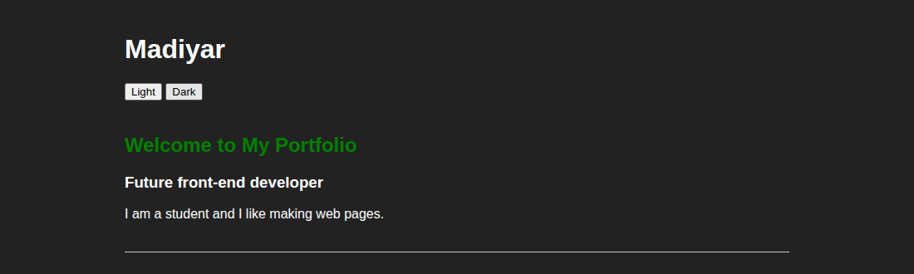
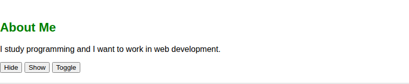
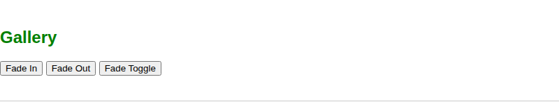
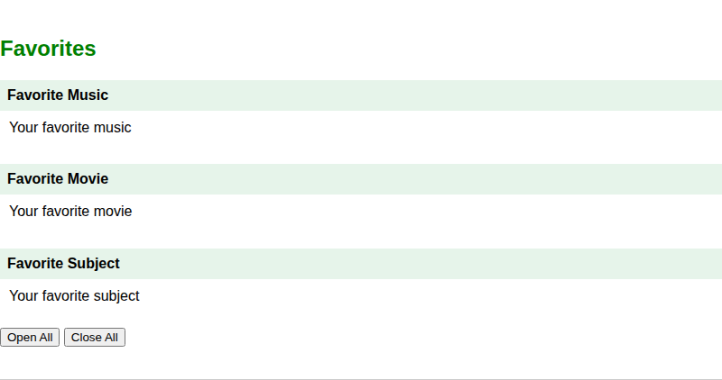
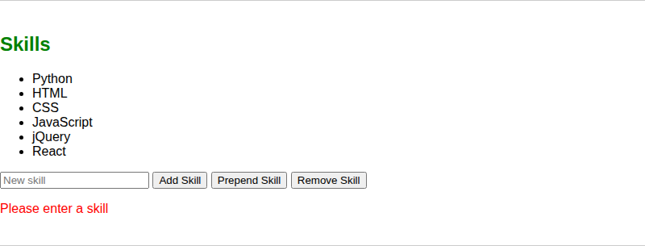
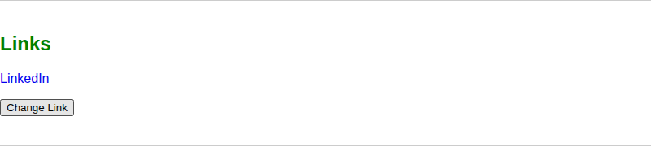
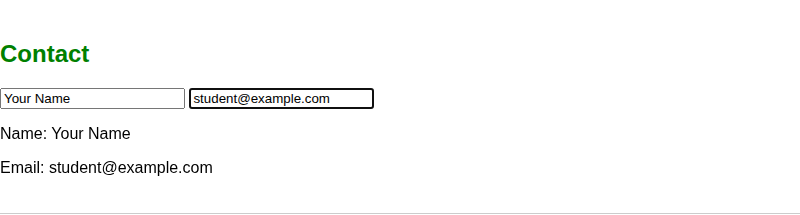
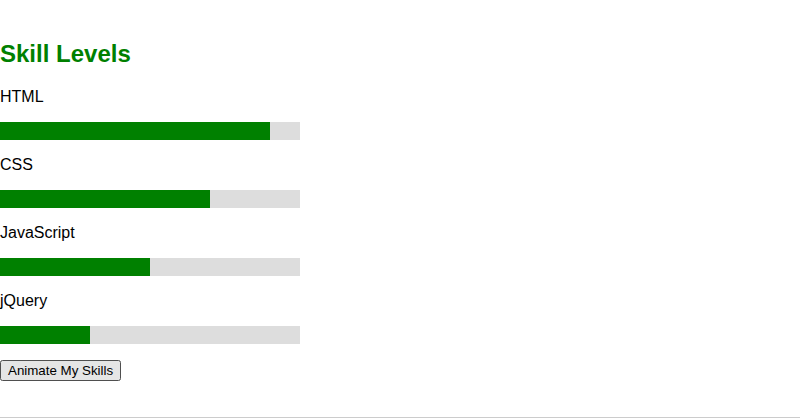

# Assignment 6. jQuery (Selectors, Effects, Animations)

Name: bissentayev Madiyar

### Task 1. Selectors & CSS
The home section has my name, a headline, a short intro and the title "Welcome to My Portfolio".  Two buttons switch between the light and the dark theme.

## Part 2. jQuery Effects

### Task 2. Visibility Methods
The About Me section has a short bio, a status message and a list of facts. The Hide, Show and Toggle buttons control the status and the facts.

### Task 3. Fade Methods

### Task 4. Slide Methods
There are three headings. Click on a heading to open or close the text under it with . The Open All and Close All buttons use `

## Part 3. DOM Manipulation with jQuery

### Task 5. Add & Remove Elements
The list starts with four skills. A new skill is typed in the input and added with  or .prepend() The last skill is deleted with .remove(). An empty input is not added and shows an error.

### Task 6. Modifying Attributes
The Change Link button changes the link address and text with .attr().

### Task 7. Form Interaction
The name and email that the user types are shown below the form while typing, using .val(` and .text().

## Part 4. Animations

There are four skill bars that start with zero width. The Animate My Skills button makes them grow to different widths with animate(). A second click returns them to zero.

## Summary
overall  this was pretty interesting topic but i didnt get the point of the topic. Because yeah , we have learned some interesting function but i have never seen that some website uses funtions like that.